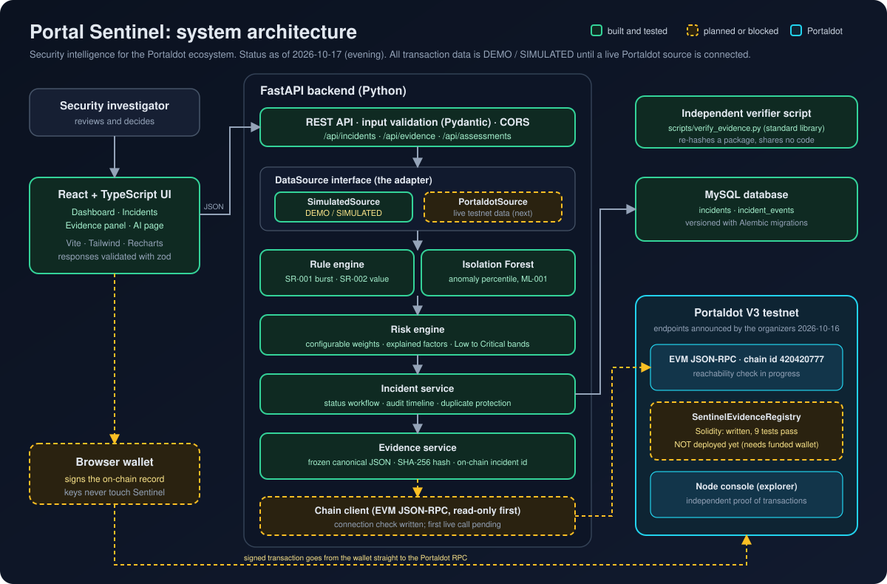
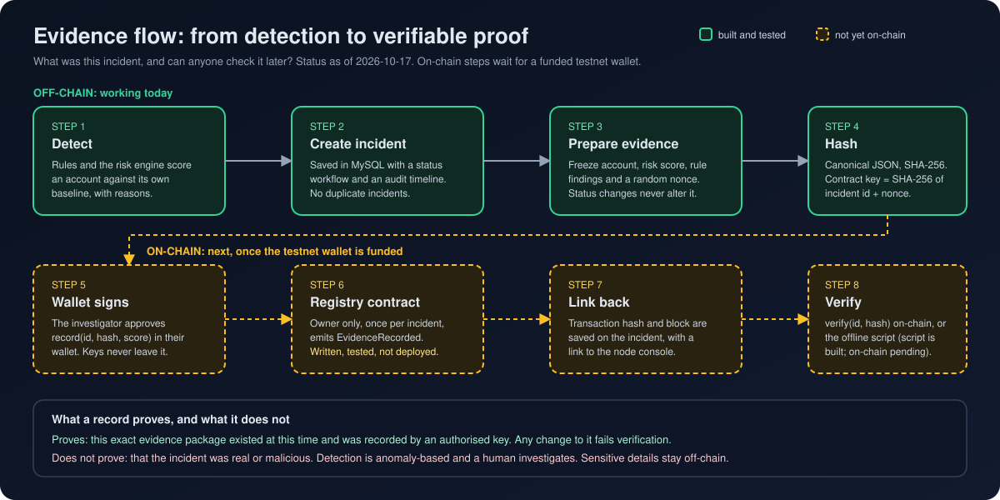

# Architecture

Portal Sentinel is a security intelligence and observability layer for the Portaldot ecosystem. It turns raw activity into
**explained risk**, tracks each alert as an **incident**, and can anchor a **tamper-evident fingerprint** of an incident on-chain.

Status as of 2026-10-17. All transaction data is **DEMO / SIMULATED** until a live Portaldot data source is connected.

## Components and status

| Component | What it does | Status |
|---|---|---|
| React + TypeScript UI | Dashboard, incident list and detail, evidence panel. API responses are validated with zod. | Built |
| FastAPI backend | REST API, input validation (Pydantic), strict CORS, clean error handling. | Built |
| DataSource interface | The adapter. Everything above it is unaware of where transactions come from. | Built |
| SimulatedSource | Deterministic generator, labelled DEMO / SIMULATED on every record (`data_origin`). | Built |
| PortaldotSource | Reads live testnet data through the same interface. | Planned (endpoints now announced) |
| Rule engine | SR-001 Transaction Burst and SR-002 Value Anomaly, each compared with the account's own baseline. | Built |
| Isolation Forest (ML-001) | Unsupervised anomaly signal. Each hour is compared with its own account's normal; the score becomes a percentile with explained feature shifts. See `AI_MODEL.md`. | Built |
| Risk engine | Noisy-OR combination of weighted findings, Low to Critical bands, explained factors. | Built |
| Incident service | Status workflow with legal transitions, audit timeline, duplicate protection. | Built |
| Evidence service | Frozen canonical JSON, SHA-256 hash, on-chain incident id. | Built |
| Independent verifier | `scripts/verify_evidence.py`, standard library only, shares no code with the backend. | Built |
| MySQL | Incidents and timeline, versioned with Alembic migrations. | Built |
| SentinelEvidenceRegistry | Solidity contract, owner-only, one record per incident, two-step ownership. | Written, 9 tests pass, **not deployed** |
| Wallet signing | Investigator approves the on-chain record in a browser wallet. | Planned |

## Key design decisions

1. **Adapter first.** Detection, risk and incidents depend only on the `DataSource` interface, so swapping simulated data for
   live Portaldot data is one new class, not a rewrite.
2. **Each account is compared with itself.** A busy account is not suspicious for being busy. Rules use a per-account baseline
   and report a confidence that falls when history is thin.
3. **Explainable risk.** Every score lists its factors with percentages and the evidence numbers behind each rule.
   Wording is deliberate: "anomalous behaviour requiring investigation", never "malicious".
4. **Evidence is a hash, not data.** The chain stores a fingerprint, a risk score and a timestamp. Details stay off-chain.
5. **Canonical, verifiable hashing.** Sorted keys, fixed-decimal floats, UTF-8, SHA-256. Python, an independent Node
   implementation and the standalone script produce identical hashes, and a pinned test vector guards the format.
6. **A random nonce in every package** makes the hash unguessable and makes the contract key unpredictable, so nobody can
   reserve the id of an incident that has not been prepared yet.
7. **Server owns the rules.** Legal status transitions and duplicate protection live in the backend and the database, not the UI.

## Security posture

Implemented: Pydantic input validation, exact-origin CORS (never `*`), a least-privilege database user, secrets only in
git-ignored `.env`, clean 503 errors with no stack traces, parameterised queries through SQLAlchemy, contract access control with
named custom errors, duplicate protection in code and by a database unique constraint.

Not yet implemented, and stated plainly:

- **No authentication** on the API. Acceptable on localhost only; required before any public deployment.
- **One owner key** controls recording on the contract. A stolen key could record false evidence but could never alter or
  delete existing records.
- Rule and model thresholds are reasonable starting points, not tuned on real network data.
- The contract has not run on Portaldot. Whether plain EVM bytecode deploys directly there is unconfirmed.

## What a record proves

An on-chain record proves that this exact evidence package existed at this time and was recorded by an authorised key.
It does not prove the incident was real or malicious. A human investigates.
